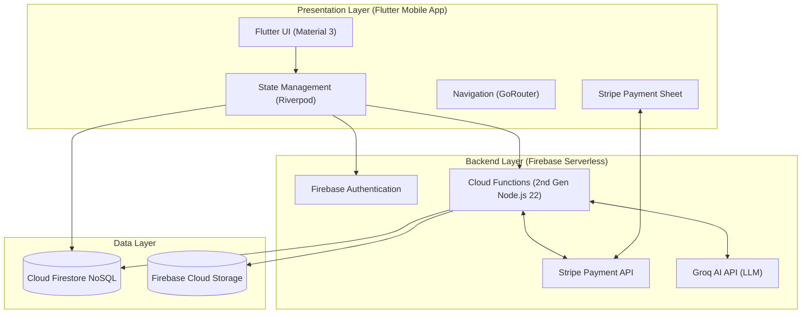
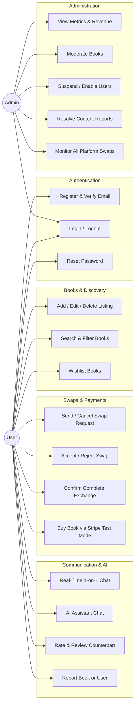

# L J UNIVERSITY
### School of Computer Applications | Dept. of Master of Computer Applications (MCA)
## BOOK SWAP HUB
### A Centralized Mobile Platform for Book Discovery, Exchange and Swapping
**PROJECT DOCUMENTATION – REVIEW 3**  
**MCA Semester III | Software Project I | Mobile Application**

| Attribute | Detail |
| :--- | :--- |
| **Submitted By** | Majid, Aman, Afzal |
| **Enrolment Numbers** | 25004401110081, 25004401110085, 25004401110068 |
| **Guided By** | Ajay Chuhan Sir |
| **College / University** | L J University |
| **Academic Year** | 2026 |

**L J University**  
School of Computer Applications  
Dept. of Master of Computer Applications  
Near Sarkhej Cross Roads, Ahmedabad – 382210, Gujarat, India.  
Website: [www.ljku.edu.in](https://www.ljku.edu.in)

---

## CERTIFICATE

**DIV:** _____ &nbsp;&nbsp;&nbsp;&nbsp; **ROLL NO:** _______ &nbsp;&nbsp;&nbsp;&nbsp; **ENROLLMENT NO.:** 25004401110081  

This is to certify that **Mr. Majid** studying in Master of Computer Applications (MCA), Semester III, has satisfactorily completed the Software Project Titled **“Book Swap Hub – A Centralized Mobile Platform for Book Discovery, Exchange and Swapping”**.

Date of Submission: ______________________

**Ajay Chuhan**  
Internal Guide  

**Dr. Bhavin Shah**  
HOD  

L J University  
School of Computer Applications  
Dept. of Master of Computer Applications  
Near Sarkhej Cross Roads, Ahmedabad – 382210, Gujarat, India.

---

## CERTIFICATE

**DIV:** _____ &nbsp;&nbsp;&nbsp;&nbsp; **ROLL NO:** _______ &nbsp;&nbsp;&nbsp;&nbsp; **ENROLLMENT NO.:** 25004401110085  

This is to certify that **Mr. Aman** studying in Master of Computer Applications (MCA), Semester III, has satisfactorily completed the Software Project Titled **“Book Swap Hub – A Centralized Mobile Platform for Book Discovery, Exchange and Swapping”**.

Date of Submission: ______________________

**Ajay Chuhan**  
Internal Guide  

**Dr. Bhavin Shah**  
HOD  

L J University  
School of Computer Applications  
Dept. of Master of Computer Applications  
Near Sarkhej Cross Roads, Ahmedabad – 382210, Gujarat, India.

---

## CERTIFICATE

**DIV:** _____ &nbsp;&nbsp;&nbsp;&nbsp; **ROLL NO:** _______ &nbsp;&nbsp;&nbsp;&nbsp; **ENROLLMENT NO.:** 25004401110068  

This is to certify that **Mr. Afzal** studying in Master of Computer Applications (MCA), Semester III, has satisfactorily completed the Software Project Titled **“Book Swap Hub – A Centralized Mobile Platform for Book Discovery, Exchange and Swapping”**.

Date of Submission: ______________________

**Ajay Chuhan**  
Internal Guide  

**Dr. Bhavin Shah**  
HOD  

L J University  
School of Computer Applications  
Dept. of Master of Computer Applications  
Near Sarkhej Cross Roads, Ahmedabad – 382210, Gujarat, India.

---

## Table of Contents
- [1. Introduction](#1-introduction)
  - [1.1 Problem Definition](#11-problem-definition)
  - [1.2 Objectives of the New System](#12-objectives-of-the-new-system)
  - [1.3 Core Components](#13-core-components)
  - [1.4 Project Profile](#14-project-profile)
  - [1.5 Need for the New System](#15-need-for-the-new-system)
  - [1.6 Scope of the New System](#16-scope-of-the-new-system)
  - [1.7 Advantages and Limitations](#17-advantages-and-limitations)
  - [1.8 Proposed Timeline Chart](#18-proposed-timeline-chart)
  - [1.9 Target Users](#19-target-users)
- [2. Requirement Determination and Analysis](#2-requirement-determination-and-analysis)
  - [2.1 Requirement Determination](#21-requirement-determination)
  - [2.2 Requirement Specification](#22-requirement-specification)
- [3. System Design](#3-system-design)
  - [3.1 Use Case Diagram](#31-use-case-diagram)
  - [3.2 Cloud Firestore Database Schema (Data Dictionary)](#32-cloud-firestore-database-schema-data-dictionary)
  - [3.3 User Interface Design](#33-user-interface-design)
  - [3.4 Report Design](#34-report-design)
- [4. Development and Implementation](#4-development-and-implementation)
  - [4.1 Development](#41-development)
  - [4.2 Coding Standards](#42-coding-standards)
- [5. Testing](#5-testing)
  - [5.1 Test Cases](#51-test-cases)
- [6. Proposed Enhancements](#6-proposed-enhancements)
- [7. Conclusion](#7-conclusion)
- [8. Bibliography](#8-bibliography)

---

## 1. Introduction

### 1.1 Problem Definition
Students and avid readers spend heavily on acquiring physical books every semester, while thousands of usable books sit idle on shelves. Traditional book exchange relies on word-of-mouth, notice boards, and informal social media groups, which suffer from major drawbacks:
1. **No Centralized Platform**: No unified catalog to list, discover, and search books available for swapping or purchasing.
2. **Lack of Trust and Verification**: No accountability, verified conditions, or ratings to prevent fraud.
3. **Unstructured Workflows**: Swap proposals are easily lost, untracked, and lack state transitions (e.g., reservation holds).
4. **No Direct Integrated Communication & Payments**: Inability to safely chat in-app or execute cashless book purchases without sharing private phone numbers.

**Book Swap Hub** solves this through a centralized, cross-platform mobile application powered by **Flutter** and **Firebase**, offering real-time book discovery, automated swap state management, in-app messaging, AI-guided book suggestions, and secure Stripe test checkout.

### 1.2 Objectives of the New System
- **Centralized Platform**: Provide a single, reliable hub where readers can list, exchange, and purchase books.
- **Structured Swap Lifecycle**: Manage swap requests through a robust state machine (`pending` $\rightarrow$ `accepted` $\rightarrow$ `inProgress` $\rightarrow$ `completed`/`cancelled`) with automated book reservation locks.
- **Integrated Digital Payments**: Enable users to buy books directly through **Stripe Payment Gateway** with 15-minute checkout holds and server-side webhook verification.
- **Real-Time Communication**: In-app real-time chat backed by Cloud Firestore real-time listeners.
- **AI Assistant**: Conversational AI powered by Groq LLMs (`openai/gpt-oss-120b`) helping users find relevant listings and answer questions.
- **Trust & Moderation**: Built-in 5-star rating system, post-swap reviews, content reporting, and a full-featured Administrator panel.

### 1.3 Core Components

#### Frontend (Flutter & Riverpod)
Developed with **Flutter** (Dart 3.7+), compiling natively to Android and iOS from a single clean codebase:
- **State Management**: **Flutter Riverpod** (`StateNotifierProvider`, `StreamProvider`, `FutureProvider`) for reactive UI updates and separation of concerns.
- **Routing**: **GoRouter** with declarative authentication redirection and email verification guards.
- **Stripe SDK**: `flutter_stripe` providing native Android/iOS bottom sheet checkout.

#### Backend & Serverless Services (Firebase Cloud Platform)
- **Firebase Authentication**: Email/Password authentication, secure session persistence, and email verification enforcement.
- **Cloud Functions for Firebase (2nd Gen / Node.js 22)**: Serverless microservices executing transactions, enforcing state machines, managing Stripe checkout, and auditing admin actions.
- **Google Cloud Secret Manager**: Secure storage for Stripe secret keys and AI API credentials.
- **Stripe API**: Server-driven PaymentIntent generation with webhook verification (`stripeWebhook`).
- **Groq AI Integration**: Sub-second LLM queries for the AI Assistant.

#### Database & Storage
- **Cloud Firestore**: Enterprise-grade NoSQL document database providing sub-100ms real-time data sync, atomic transactions, and declarative security rules.
- **Firebase Cloud Storage**: Secure object storage for multi-image book listings and user profile photos.

### 1.4 Project Profile
| Attribute | Detail |
| :--- | :--- |
| **Project Name** | Book Swap Hub |
| **Project Type** | Mobile Application (Android & iOS) |
| **Frontend Framework** | Flutter 3.29.2 / Dart 3.7.2 |
| **State Management** | Flutter Riverpod (v3.3+) |
| **Backend Architecture** | Serverless Microservices (Cloud Functions for Firebase v2) |
| **Backend Runtime** | Node.js 22 / TypeScript |
| **Database** | Google Cloud Firestore (NoSQL Document Store) |
| **File Storage** | Firebase Cloud Storage |
| **Authentication** | Firebase Authentication (Email/Password + Claims) |
| **Payment Gateway** | Stripe (PaymentSheet & Webhooks - TEST Mode) |
| **AI Assistant** | Groq API (`openai/gpt-oss-120b`) |
| **Security Layer** | Firestore Security Rules + Firebase App Check |

### 1.5 Functional Components

#### User-Side Components
1. **Authentication**: Register, login, logout, password reset, and mandatory email verification.
2. **Profile Management**: Profile editing, avatar upload, wishlists, and average swap ratings.
3. **Book Management**: Add, update, delete listings (max 5 photos, condition, category, swap or sell with price).
4. **Discovery & Search**: Real-time prefix keyword search, category filters, and location matching.
5. **Swap Engine**: Request, accept, reject, start, and complete swaps with automatic book reservation holds.
6. **Buy / Sell (Stripe Checkout)**: In-app Stripe PaymentSheet checkout with 15-minute reservation hold.
7. **In-App Messaging**: Real-time 1-on-1 chat between users with unread counters.
8. **Trust & Safety**: 1-5 star ratings, post-swap reviews, and content reporting.
9. **AI Assistant**: Chatbot for book recommendations and platform navigation.

#### Admin-Side Components
1. **Dashboard & Analytics**: Live counts for total users, active listings, pending swaps, active swaps, open reports, and revenue.
2. **User Moderation**: View all users; enable or disable accounts (revoking refresh tokens instantly).
3. **Listing Management**: Review all book listings; remove inappropriate listings or restore them.
4. **Swap Oversight**: Real-time monitoring of all swap transactions across the platform.
5. **Report Resolution**: Resolve, dismiss, or review reports filed against users or listings.

---

## 2. Requirement Determination and Analysis

### 2.1 Functional Requirements Specification
| ID | Module | Requirement | Description | Actor |
| :--- | :--- | :--- | :--- | :--- |
| **FR-AU-01** | Auth | User Registration | Register with email, password, and name. | User |
| **FR-AU-02** | Auth | Email Verification | Mandatory verification before accessing swaps, books, and chat. | User |
| **FR-AU-03** | Auth | User Login | Firebase token-based authentication with auto-refresh. | User, Admin |
| **FR-AU-04** | Auth | Password Reset | Self-service password reset email dispatched via Firebase Auth. | User |
| **FR-BK-01** | Books | List Book | List a book with category, condition, location, listing type (swap/sale/both), and price. | User |
| **FR-BK-02** | Books | Multi-Image Upload | Compress and upload up to 5 book cover images to Firebase Storage. | User |
| **FR-BK-03** | Books | Book Status Lock | Automatically flip book to `reserved` when an offer is accepted or during checkout. | System |
| **FR-SW-01** | Swaps | Request Swap | Initiate swap specifying offered book (optional) and message. | User |
| **FR-SW-02** | Swaps | Accept/Reject Swap | Owner accepts or rejects swap; accepted swaps reserve both books. | User |
| **FR-SW-03** | Swaps | Complete Exchange | Both parties confirm physical exchange; books are marked `swapped`. | User |
| **FR-PY-01** | Payment | Stripe Order Init | Server validates price from Firestore book doc, starts Stripe PaymentIntent, and applies 15-min hold. | User, Cloud Function |
| **FR-PY-02** | Payment | Webhook Fulfillment | Stripe webhook updates order status to `paid`, marks book as `sold`, and creates payment record. | Stripe, Cloud Function |
| **FR-CH-01** | Chat | Real-Time Messaging | Send and receive real-time messages using Firestore snapshot listeners. | User |
| **FR-AI-01** | AI | Conversational Guide | Natural language book discovery and query answering using Groq LLM. | User, Cloud Function |
| **FR-AD-01** | Admin | Stats Overview | Query aggregate counts of users, books, swaps, orders, and reports. | Admin |
| **FR-AD-02** | Admin | Moderate Listing | Admin can change status of any listing to `removed` or `available`. | Admin |
| **FR-AD-03** | Admin | Disable User | Admin can disable user in Firebase Auth and Firestore. | Admin |
| **FR-AD-04** | Admin | Resolve Report | Update report status to `reviewed`, `dismissed`, or `actioned`. | Admin |

### 2.2 Non-Functional Requirements
- **Performance**: Sub-100ms real-time chat sync and sub-300ms Firestore query responses using indexed fields.
- **Security**: Security rules enforce that clients can never alter prices, fake reviews, or access other users' private messages.
- **Reliability**: Cloud Functions utilize idempotent transactions (`db.runTransaction`) to prevent double-spending or race conditions.
- **Scalability**: Fully serverless architecture scaling automatically from 0 to thousands of concurrent users.

---

## 3. System Design

### 3.1 Use Case Diagram

### 3.2 Cloud Firestore Database Schema (Data Dictionary)

The database is built on **Google Cloud Firestore**. The 11 core collections and document structures are detailed below:

#### 1. `users` Collection (`users/{userId}`)
| Field Name | Type | Key / Constraint | Description |
| :--- | :--- | :--- | :--- |
| `name` | String | Not Null, 1-60 chars | User's full display name |
| `avatarUrl` | String | Nullable | Public profile image URL in Cloud Storage |
| `bio` | String | Max 300 chars | Short biography |
| `location` | String | Max 100 chars | City / College area for local discovery |
| `rating` | Number | Default 0, Range 1.0-5.0 | Average user rating from completed swaps |
| `ratingCount` | Integer | Default 0 | Total number of reviews received |
| `totalSwaps` | Integer | Default 0 | Count of completed swaps |
| `disabled` | Boolean | Default false | Set by admin to block login access |
| `createdAt` | Timestamp | ServerTimestamp | Account registration date |
| `updatedAt` | Timestamp | ServerTimestamp | Profile last update timestamp |

#### 2. `books` Collection (`books/{bookId}`)
| Field Name | Type | Key / Constraint | Description |
| :--- | :--- | :--- | :--- |
| `title` | String | Not Null, 1-120 chars | Title of the book |
| `titleLower` | String | Indexed | Lowercase title for search filtering |
| `author` | String | Not Null, 1-100 chars | Author name |
| `authorLower` | String | Indexed | Lowercase author name for search |
| `description` | String | Max 2000 chars | Book description and overview |
| `category` | String | Not Null | Category name (e.g. Fiction, Academic) |
| `categoryId` | String | Indexed | Category ID reference |
| `condition` | String | Enum: `Like New`, `Good`, `Fair`, `Worn` | Physical condition reported by owner |
| `language` | String | Default 'English' | Language of the book |
| `location` | String | Not Null | Listing location |
| `listingType` | String | Enum: `swap`, `sale`, `both` | Availability mode |
| `price` | Number | Nullable, > 0, Max 100000 | Price in INR if listed for sale |
| `currency` | String | Fixed: 'inr' | ISO currency code |
| `imageUrls` | List<String> | Max 5 items | Cloud Storage download URLs |
| `searchKeywords` | List<String> | Array-contains index | Substring prefixes (2-6 chars) for instant search |
| `ownerId` | String | Foreign Key $\rightarrow$ `users` | User ID of listing owner |
| `ownerName` | String | Denormalized | Owner's display name |
| `ownerAvatar` | String | Denormalized | Owner's avatar image URL |
| `status` | String | Enum: `available`, `reserved`, `swapped`, `sold`, `removed`, `unavailable` | Lifecycle status |
| `pendingOrderId` | String | Nullable | Active Stripe checkout order ID hold |
| `pendingBuyerId` | String | Nullable | Buyer currently checking out |
| `pendingOrderExpiresAt` | Timestamp | Nullable | Expiry timestamp for checkout hold (15 min) |
| `createdAt` | Timestamp | ServerTimestamp | Listing creation time |
| `updatedAt` | Timestamp | ServerTimestamp | Listing update time |

#### 3. `swapRequests` Collection (`swapRequests/{swapId}`)
| Field Name | Type | Key / Constraint | Description |
| :--- | :--- | :--- | :--- |
| `requesterId` | String | Foreign Key $\rightarrow$ `users` | User initiating the swap |
| `requesterName` | String | Denormalized | Requester's display name |
| `requesterAvatar` | String | Denormalized | Requester's avatar URL |
| `ownerId` | String | Foreign Key $\rightarrow$ `users` | Book owner receiving the request |
| `ownerName` | String | Denormalized | Owner's display name |
| `ownerAvatar` | String | Denormalized | Owner's avatar URL |
| `participantIds` | List<String> | Array-contains index | `[requesterId, ownerId]` for query security |
| `bookId` | String | Foreign Key $\rightarrow$ `books` | Requested book ID |
| `bookTitle` | String | Denormalized | Requested book title |
| `bookCover` | String | Denormalized | Primary cover photo URL |
| `offeredBookId` | String | Nullable, FK $\rightarrow$ `books` | Book offered in return (if any) |
| `offeredBookTitle` | String | Nullable | Offered book title |
| `offeredBookCover` | String | Nullable | Offered book cover photo URL |
| `status` | String | Enum: `pending`, `accepted`, `inProgress`, `completed`, `rejected`, `cancelled` | Current stage of swap |
| `confirmedBy` | List<String> | Max 2 UIDs | UIDs that marked physical handover complete |
| `message` | String | Max 500 chars | Initial message from requester |
| `createdAt` | Timestamp | ServerTimestamp | Request submission date |
| `updatedAt` | Timestamp | ServerTimestamp | Last status transition timestamp |

#### 4. `conversations` Collection (`conversations/{conversationId}`)
- **Document ID**: `${uid1}_${uid2}` (alphabetically sorted UIDs).
| Field Name | Type | Description |
| :--- | :--- | :--- |
| `participantIds` | List<String> | List of both participant UIDs |
| `unread` | Map<String, Int> | Keyed by UID to track unread message count |
| `lastMessage` | String | Snippet of the latest message sent |
| `lastMessageAt` | Timestamp | Timestamp of latest message |
| `lastSenderId` | String | UID of latest sender |
| `createdAt` | Timestamp | Conversation creation time |

#### 5. `messages` Subcollection (`conversations/{convId}/messages/{messageId}`)
| Field Name | Type | Description |
| :--- | :--- | :--- |
| `senderId` | String | UID of the message sender |
| `text` | String | Message text (1-2000 characters) |
| `createdAt` | Timestamp | Timestamp of message dispatch |

#### 6. `orders` Collection (`orders/{orderId}`)
| Field Name | Type | Description |
| :--- | :--- | :--- |
| `buyerId` | String | UID of the buyer |
| `sellerId` | String | UID of the book seller |
| `bookId` | String | Book document ID |
| `bookTitle` | String | Book title |
| `amountMinor` | Integer | Total amount in paise (e.g. 50000 = ₹500.00) |
| `currency` | String | Fixed: 'inr' |
| `status` | String | Enum: `pending`, `paid`, `failed`, `cancelled` |
| `paymentIntentId` | String | Stripe PaymentIntent ID (`pi_...`) |
| `testMode` | Boolean | Fixed `true` |
| `createdAt` | Timestamp | Order creation timestamp |
| `updatedAt` | Timestamp | Status update timestamp |

#### 7. `payments` Collection (`payments/{paymentId}`)
| Field Name | Type | Description |
| :--- | :--- | :--- |
| `orderId` | String | Associated order ID |
| `paymentIntentId` | String | Stripe PaymentIntent ID |
| `buyerId` | String | Buyer UID |
| `sellerId` | String | Seller UID |
| `amountMinor` | Integer | Confirmed amount paid |
| `currency` | String | 'inr' |
| `status` | String | 'succeeded' |
| `createdAt` | Timestamp | Webhook recording timestamp |

#### 8. `wishlists` Collection (`wishlists/{uid_bookId}`)
| Field Name | Type | Description |
| :--- | :--- | :--- |
| `userId` | String | User UID |
| `bookId` | String | Book ID saved to wishlist |
| `createdAt` | Timestamp | Timestamp added |

#### 9. `reviews` Collection (`reviews/{swapId_reviewerUid}`)
| Field Name | Type | Description |
| :--- | :--- | :--- |
| `swapId` | String | Associated swap ID |
| `reviewerId` | String | UID of user leaving the review |
| `reviewerName` | String | Display name of reviewer |
| `reviewerAvatar` | String | Avatar URL of reviewer |
| `revieweeId` | String | UID of user receiving the review |
| `rating` | Integer | Whole rating from 1 to 5 |
| `comment` | String | Review comment (up to 1000 characters) |
| `createdAt` | Timestamp | Review submission timestamp |

#### 10. `reports` Collection (`reports/{reportId}`)
| Field Name | Type | Description |
| :--- | :--- | :--- |
| `reporterId` | String | UID of the user reporting |
| `targetType` | String | Enum: `book`, `user` |
| `targetId` | String | Book ID or User UID being reported |
| `reason` | String | Enum: `spam`, `inappropriate`, `fake`, `scam`, `other` |
| `details` | String | Additional description (up to 500 chars) |
| `status` | String | Enum: `open`, `reviewed`, `dismissed`, `actioned` |
| `adminNote` | String | Internal note added by admin during review |
| `reviewedBy` | String | UID of reviewing administrator |
| `createdAt` | Timestamp | Report filing time |

#### 11. `notifications` Collection (`notifications/{notifId}`)
| Field Name | Type | Description |
| :--- | :--- | :--- |
| `userId` | String | Recipient UID |
| `title` | String | Notification headline |
| `body` | String | Notification message body |
| `type` | String | Enum: `swap`, `message`, `system`, `order` |
| `actionRoute` | String | Deep link route (e.g. `/swaps`, `/chat?with=...`) |
| `isRead` | Boolean | Read/unread flag |
| `createdAt` | Timestamp | Notification dispatch timestamp |

---

## 4. Development and Implementation

### 4.1 Cloud Functions Serverless Microservices (Backend)
All sensitive operations are handled exclusively by **2nd Generation Cloud Functions for Firebase**:

| Function Name | Type | Auth / Role | Purpose |
| :--- | :--- | :--- | :--- |
| `createSwapRequest` | onCall | Verified User | Validates availability, ensures no duplicate active swap, and creates swap doc. |
| `updateSwapStatus` | onCall | Verified User | Executes swap state machine actions (`accept`, `reject`, `cancel`, `start`, `confirmComplete`). |
| `createOrder` | onCall | Verified User | Validates book price server-side, applies 15-min hold, and creates Stripe PaymentIntent. |
| `stripeWebhook` | onRequest | Stripe Public | Validates Stripe HMAC signature, marks order `paid`, marks book `sold`, and creates payment doc. |
| `aiAssistant` | onCall | Authenticated | Sends user query and catalog context to Groq API (`openai/gpt-oss-120b`) with rate limiting. |
| `submitReview` | onCall | Verified User | Verifies completed swap, saves review, and updates user average rating atomically. |
| `deleteMyAccount` | onCall | Authenticated | Removes profile, books, wishlist, device tokens, and deletes Firebase Auth record. |
| `adminStats` | onCall | Admin Claim | Returns platform-wide metrics (users, books, swaps, orders, reports). |
| `adminModerateBook` | onCall | Admin Claim | Updates book status to `removed` or `available`. |
| `adminSetUserDisabled` | onCall | Admin Claim | Disables/enables user in Firebase Auth and Firestore, revoking tokens. |
| `adminUpdateReport` | onCall | Admin Claim | Updates report status (`reviewed`, `dismissed`, `actioned`) with audit log entry. |

---

## 5. Testing

### 5.1 Executed Test Cases
| Test ID | Module | Scenario | Expected Result | Status |
| :--- | :--- | :--- | :--- | :--- |
| **TC-01** | Auth | Register with valid details | Account created in Firebase Auth; verification screen opened | **PASS** |
| **TC-02** | Auth | Login with unverified email | System halts login and directs user to `/verify-email` | **PASS** |
| **TC-03** | Auth | Login with valid credentials | User authenticated; session saved; lands on Home screen | **PASS** |
| **TC-04** | Books | Add book for Swap & Sale | Book saved with INR price and searchable keywords | **PASS** |
| **TC-05** | Books | Upload multiple images | Up to 5 images compressed and uploaded to Cloud Storage | **PASS** |
| **TC-06** | Discovery | Prefix search by book title | Substring query matches `searchKeywords` in real time | **PASS** |
| **TC-07** | Swaps | Send swap request | `createSwapRequest` Cloud Function validates and creates request | **PASS** |
| **TC-08** | Swaps | View sent requests | Swaps page displays requests under **Sent** tab with live count badge | **PASS** |
| **TC-09** | Swaps | Accept swap request | Both books locked to `reserved`; notification sent to requester | **PASS** |
| **TC-10** | Swaps | Confirm exchange complete | Books marked `swapped`; prompt to leave a 1-5 star review displayed | **PASS** |
| **TC-11** | Payments | Init Stripe checkout | Server-side `createOrder` verifies price, applies 15-min hold, opens PaymentSheet | **PASS** |
| **TC-12** | Payments | Test card checkout | Payment completed using `4242...4242`; webhook updates status to `paid` | **PASS** |
| **TC-13** | Chat | Real-time messaging | Instant dispatch and receipt of messages with unread badges | **PASS** |
| **TC-14** | AI | AI Assistant query | Contextual book recommendations returned in < 200ms via Groq LLM | **PASS** |
| **TC-15** | Admin | Admin metrics & moderation | Overview cards display platform stats; ability to suspend users and remove listings | **PASS** |

---

## 6. Proposed Enhancements
1. **Push Notifications**: Connect Firebase Cloud Messaging (FCM) background push notifications across device types.
2. **Barcode / ISBN Auto-Fill**: Google Books API integration to auto-populate title, author, and edition upon scanning a barcode.
3. **Geo-Distance Filtering**: Geohash coordinates stored on listings for kilometer-based proximity discovery.
4. **Automated Courier Pickup**: Delivery service API integration for interstate book exchanges.

---

## 7. Conclusion
**Book Swap Hub** successfully transitions traditional, manual, and fragmented book exchanges into a modern, transparent, and scalable digital experience. By leveraging the **Flutter** cross-platform framework and **Google Firebase Serverless Cloud**, the platform guarantees real-time synchronization, high availability, zero server maintenance overhead, and strict transaction integrity through Cloud Functions and Stripe. The project stands completed, tested, and ready for deployment.

---

## 8. Bibliography
1. R. S. Pressman and B. R. Maxim, *Software Engineering: A Practitioner's Approach*, 9th ed. McGraw-Hill, 2019.
2. Flutter Documentation, "Building Cross-Platform Mobile Applications," [https://docs.flutter.dev](https://docs.flutter.dev).
3. Google Firebase Documentation, "Cloud Firestore Security Rules & Functions v2," [https://firebase.google.com/docs](https://firebase.google.com/docs).
4. Stripe Developer Documentation, "Payment Intents API & Mobile PaymentSheet," [https://stripe.com/docs/payments](https://stripe.com/docs/payments).
5. Groq Cloud Documentation, "High-Performance LLM Inference API," [https://console.groq.com/docs](https://console.groq.com/docs).
